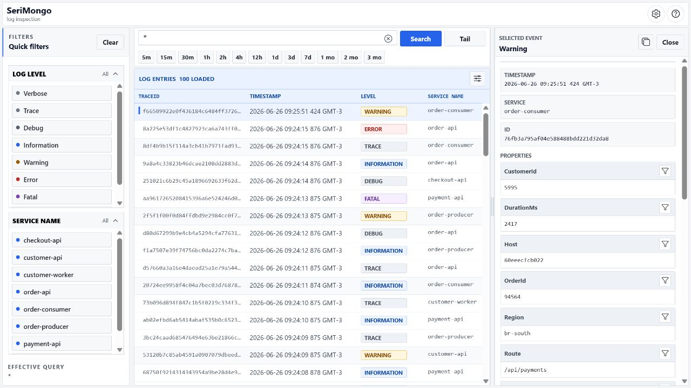
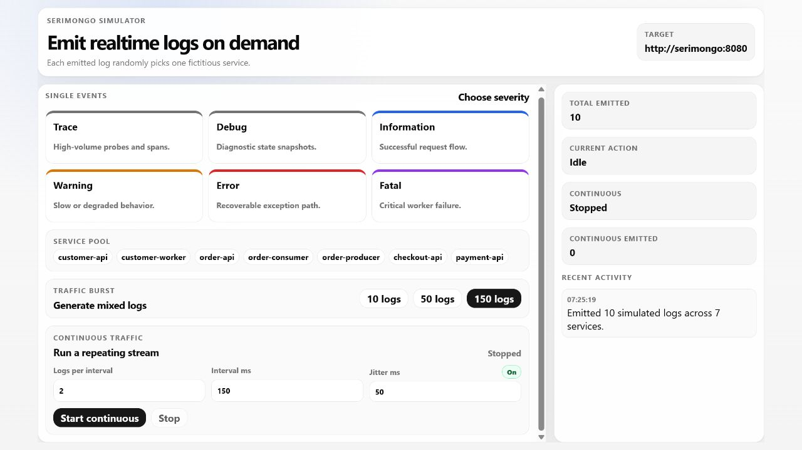

# SeriMongo

SeriMongo is a real-time log and trace viewer backed by SQLite. It receives OTLP/HTTP logs and traces, broadcasts updates to the UI with SignalR, and keeps correlated telemetry in one workspace.

## Screenshots

### Log viewer

Search, filter, tail, and inspect structured log events from the same workspace.



### Realtime simulator

Generate individual events, mixed bursts, or continuous traffic from the bundled simulator.



## Features

* SQLite storage.
* Real-time UI updates through SignalR.
* LogQL search dialect compiled to parameterized SQLite queries.
* OTLP logs receiver at `/v1/logs` and `/otlp/v1/logs` for `http/protobuf` and `http/json` exporters.
* OTLP traces receiver at `/v1/traces` and `/otlp/v1/traces` for
  `http/protobuf` and `http/json` exporters, with SQLite persistence and
  partial-success responses for rejected spans.
* Integrated trace browser, span tree, waterfall, and LogQL focus for
  correlated logs.
* Metrics compatibility endpoints that acknowledge and discard OTLP metrics.
* Docker image with Angular UI and ASP.NET Core backend.
* Docker Compose simulator UI for emitting realtime sample logs.

## Run With Docker

Build the image:

```bash
docker build -t serimongo:local .
```

Rebuilding an image does not update an existing container. Recreate the local
development container with the new image while retaining its network, host
port, and data volume:

```bash
docker rm -f serimongo
docker run -d --name serimongo \
  --network serimongo-network \
  -p 51983:8080 \
  -v serimongo-data:/data \
  serimongo:local
```

Run it:

```bash
docker run --rm -p 51983:8080 -v serimongo-data:/data serimongo:local
```

Run it with the bundled `seed.sql` enabled:

```bash
docker run --rm -p 51983:8080 \
  -e ApplicationOptions__Seed__Enabled=true \
  -e ApplicationOptions__Seed__ScriptPath=/app/seed.sql \
  -v serimongo-data:/data \
  serimongo:local
```

Or use Docker Compose, which enables the seed by default:

```bash
docker compose up --build
```

The seed setting can be overridden from the command line without editing the
Compose file. In PowerShell:

```powershell
$env:ApplicationOptions__Seed__Enabled = "false"
docker compose up --build
```

In Bash or another POSIX shell:

```bash
ApplicationOptions__Seed__Enabled=false docker compose up --build
```

The override disables startup seeding but does not delete data already stored
in the `serimongo-data` volume.

Open the UI:

```text
http://localhost:51983
```

Open the simulator UI and click a severity button to send logs to SeriMongo:

```text
http://localhost:51984
```

The container stores SQLite data at `/data/serimongo.db`. Override it with:

```bash
docker run --rm -p 51983:8080 \
  -e ApplicationOptions__Database__ConnectionString="Data Source=/data/custom.db" \
  -v serimongo-data:/data \
  serimongo:local
```

## Seed Data

The Docker image includes `seed.sql`, a compact SQLite script that generates 3000 varied log entries. Startup seeding runs only when both conditions are met:

* `ApplicationOptions__Seed__Enabled=true`
* the configured `ApplicationOptions__Seed__ScriptPath` file exists

The bundled script is idempotent: it inserts only when `LogEntries` is empty, so restarts do not duplicate seed data.

## Simulator

The simulator is a separate ASP.NET Core + Angular app in `Simulator/SeriMongo.Simulator`. Docker Compose runs it on port `51984` and configures it to post OTLP/HTTP JSON logs to the main `serimongo` service.

Configure a different target with:

```text
SimulatorOptions__TargetBaseUrl=http://localhost:51983
```

The UI emits one correlated logical operation for each action: one log is
attached to its processing span and four related spans are exported as an OTLP
trace. Mixed bursts and continuous traffic preserve that correlation.

## LogQL

The search box accepts LogQL expressions. Values are always passed to SQLite as parameters; only known log fields and sanitized `prop.<name>` paths are converted to SQL.

Fields:

* `id`
* `timestamp`
* `level`
* `message`
* `exception`
* `prop.<name>` for structured properties

Operators:

* `=`, `!=`, `>`, `>=`, `<`, `<=`
* `contains`, `startswith`, `endswith`
* `in (...)`
* `exists`
* `and`, `or`, parentheses

Examples:

```text
*
level = Error
level in (Error, Warning) and timestamp >= "2026-01-01T00:00:00Z"
message contains "checkout failed"
exception exists
prop.CustomerId = 42 or prop.Country = "Brazil"
```

The dialect metadata is also available at:

```text
GET /api/search/dialect
```

## HTTP Log Ingestion

Insert a log directly:

```bash
curl -X POST http://localhost:51983/api/applogs \
  -H "Content-Type: application/json" \
  -d '{
    "level": "Error",
    "renderedMessage": "checkout failed",
    "properties": { "CustomerId": 42, "Country": "Brazil" }
  }'
```

Search logs:

```bash
curl -X POST "http://localhost:51983/api/search?currentPage=1&pageSize=100" \
  -H "Content-Type: application/json" \
  -d '{ "query": "level = Error and prop.CustomerId = 42" }'
```

## OTLP Logs

The receiver supports OTLP/HTTP Protobuf and JSON. The .NET OpenTelemetry
exporter uses `http/protobuf`:

```text
OTEL_EXPORTER_OTLP_ENDPOINT=http://localhost:51983
OTEL_EXPORTER_OTLP_PROTOCOL=http/protobuf
```

Exporters that support OTLP/HTTP JSON can use
`OTEL_EXPORTER_OTLP_PROTOCOL=http/json` instead.

Successful Protobuf requests receive an empty
`ExportLogsServiceResponse` with `Content-Type: application/x-protobuf`, as
defined by OTLP/HTTP. JSON requests continue to receive an empty JSON object.

The trace receiver exposes `/v1/traces` and `/otlp/v1/traces`. It persists
OTLP/HTTP Protobuf and JSON spans, returns a matching successful export
response, and uses partial success when individual spans have invalid IDs or
timestamps. The workspace can browse traces, inspect their span hierarchy and
waterfall, and focus correlated logs through `?traceId=<id>`.

The metrics endpoints `/v1/metrics` and `/otlp/v1/metrics` remain compatibility
endpoints: they acknowledge OTLP Protobuf and JSON payloads but discard their
contents.

Send a minimal OTLP/HTTP JSON payload:

```bash
curl -X POST http://localhost:51983/v1/logs \
  -H "Content-Type: application/json" \
  -d '{
    "resourceLogs": [
      {
        "resource": {
          "attributes": [
            { "key": "service.name", "value": { "stringValue": "checkout-api" } }
          ]
        },
        "scopeLogs": [
          {
            "scope": { "name": "sample" },
            "logRecords": [
              {
                "severityText": "ERROR",
                "body": { "stringValue": "checkout failed" },
                "attributes": [
                  { "key": "CustomerId", "value": { "intValue": "42" } }
                ]
              }
            ]
          }
        ]
      }
    ]
  }'
```

## Local Development

Use this workflow to run the ASP.NET Core API and the Angular frontend on your
computer. They are two separate processes, so keep two terminals open.

The commands below use PowerShell and assume your current directory is the
repository root (the folder that contains `SeriMongo.sln`).

### Before You Start

Install the following tools:

* a .NET SDK compatible with `SeriMongo/SeriMongo.csproj`;
* Node.js 22.22.3+, Node.js 24.15.0+, or a newer supported version; and
* npm, which is installed with Node.js.

Check that they are available:

```powershell
dotnet --version
node --version
npm --version
```

### 1. Start the Backend

In the first terminal, from the repository root, run:

```powershell
dotnet run --project SeriMongo/SeriMongo.csproj --urls http://localhost:51983
```

Leave this terminal running. The API is now listening at
`http://localhost:51983`.

### 2. Install and Start the Frontend

Open a second terminal. From the repository root, run:

```powershell
Set-Location .\SeriMongo
npm install
npm start
```

`npm install` downloads the frontend dependencies. You need it after cloning
the repository and whenever `package.json` changes. `npm start` starts the
Angular development server, watches the frontend files, and rebuilds the UI
when you save a change.

Do not use `npm run dev`: this project does not define a `dev` script.

### 3. Open SeriMongo

When Angular reports that the application compiled successfully, open:

```text
http://localhost:4200
```

Use this Angular URL while developing the frontend. Its development server
automatically forwards UI requests to the backend at
`http://localhost:51983`, including API calls and the realtime SignalR
connection. You do not need to change frontend URLs or configure CORS.

Keep both terminals running. Press `Ctrl+C` in either terminal to stop that
part of the application.

### Common Problems

* **The page shows API or realtime connection errors:** make sure the backend
  terminal is still running on port `51983`.
* **Port `4200` is already in use:** start Angular on another port with
  `npm start -- --port 4201`, then open `http://localhost:4201`.
* **`npm install` rejects your Node.js version:** install Node.js 22.22.3+ or
  Node.js 24.15.0+ before trying again.
* **Dependencies appear broken after a package change:** from `SeriMongo`, run
  `Remove-Item -Recurse -Force node_modules` and then `npm install`.

### Build the Frontend Without Local Node.js

Docker can build the frontend when a compatible local Node.js version is not
available. This command creates a production build but does not start the
development server. It keeps Linux dependencies in a Docker volume so they do
not interfere with `npm` commands run on Windows:

```powershell
docker volume create serimongo-node-modules
docker run --rm --mount "type=bind,source=$((Get-Location).Path)\SeriMongo,target=/app" --mount "type=volume,source=serimongo-node-modules,target=/app/node_modules" -w /app node:24-alpine sh -c "npm install && npm run build"
```
